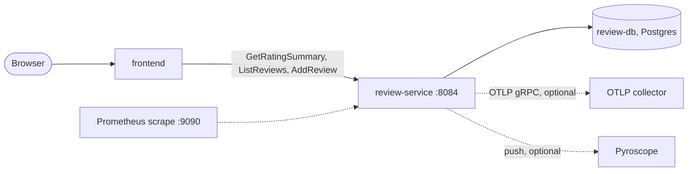

# Architecture

## Context



review-service calls no other service. The caller is the frontend (`ListReviews`, `GetRatingSummary` and `AddReview`; checked against the `origin/main` code of the callers on 2026-11-21).

## Main flow: adding and reading a review

```mermaid
sequenceDiagram
    participant FE as frontend
    participant RV as review-service
    participant DB as review-db
    FE->>RV: GetRatingSummary(product_ids)
    RV->>DB: one SQL statement: count, avg, count FILTER per star
    RV-->>FE: summaries (stars on the cards)
    FE->>RV: AddReview(product, author, rating, comment)
    RV->>RV: validate, rate limit (in memory, per process)
    RV->>DB: BEGIN; advisory lock; duplicate check; INSERT; COMMIT
    RV-->>FE: Review (or ALREADY_EXISTS / RESOURCE_EXHAUSTED)
    FE->>RV: ListReviews(product, page)
    RV-->>FE: reviews, total, average_rating
```

If this service is down the frontend renders pages without stars and answers 503 when posting (frontend behaviour as documented in the frontend's README; not run against a stopped review-service for this page).

## Start-up and readiness

1. Telemetry and profiling are configured (both off unless their variables are set).
2. The gRPC server listens at once, health is `NOT_SERVING`.
3. A background loop runs the goose migrations and the seed (retry every 2 s), then pings the database every 5 s; health follows the ping.

## Rating summaries

Average, count and the five star buckets of `GetRatingSummary` come out of one SQL statement (`count(*) FILTER (WHERE rating = k)`), i.e. one snapshot, so a concurrent `AddReview` can never make them disagree (`sum(star_counts) == count`).

## Abuse limits

No authentication exists, so the author name is just text the caller sends. A review is rejected as a duplicate (same product, author and text, case-insensitive, checked under an advisory lock in the insert transaction). A rate limit per product + author name (default 5 per minute) is held in memory per process. Details: [API](api.md).
